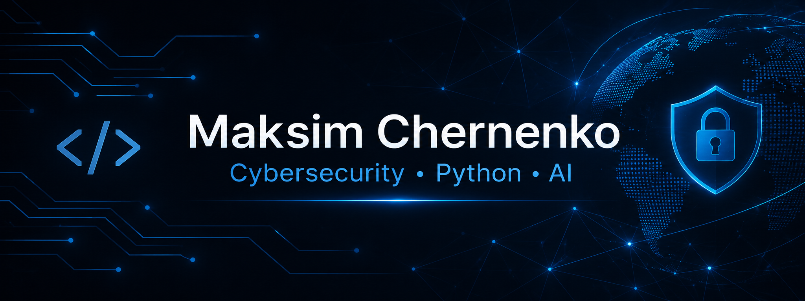

### Cybersecurity Student · Python Developer · AI Enthusiast

---

## 👋 About Me

Hi! I'm **Maksim Chernenko**, a first-year Cybersecurity student at **MIREA — Russian Technological University**.

I'm interested in the intersection of **cybersecurity, software development, and artificial intelligence**. I enjoy building practical tools, experimenting with APIs, and exploring how applications and networks work.

- 🐍 Building projects with **Python**
- 🤖 Developing **Telegram bots** and integrating AI-powered features
- 🌐 Creating websites and working with web technologies
- 🛡️ Learning **Application Security** and **Network Security**
- 🧠 Exploring AI integrations and the practical use of language models

I'm currently focused on strengthening my software development foundations while learning how to build more secure applications.

## 🧰 Tech Stack

### Languages & Web

  
  
  
  
  

### Tools & Technologies

  
  
  
  
  

## 🎯 Current Focus

- Learning the fundamentals of **Application Security (AppSec)**
- Exploring **Network Security**, networking, and web technologies
- Improving Python skills and software design
- Building useful Telegram bots and AI-powered integrations
- Practicing Git, databases, and API development

## 🚀 What I Build

- **Telegram bots** — chat-based tools, automation, and integrations
- **AI-powered features** — connecting applications with AI APIs
- **Websites** — responsive interfaces and web projects

> This profile is a work in progress. I'll add individual project cards and repository links as I publish and document my projects.

## 📊 GitHub Stats

---

## 🤝 Connect with Me

- Telegram: **[@Illdomyself](https://t.me/Illdomyself)**
- Email: **maksaurafarmer@gmail.com**

---

*Build · Learn · Improve*

